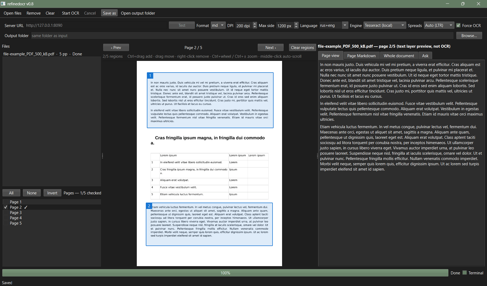

# yomu-ocr

A local-first OCR app for scanned documents, PDFs and comic archives. It has a
CLI and a PySide6 desktop GUI. Tesseract is the default OCR engine; an optional
OpenAI-compatible multimodal model served by `llama-server` can be used instead.

**Status:** pre-release / work in progress. The repository name is
`yomu-ocr`; the current CLI entry point is still `src/refinedocr.py` and the
GUI is `src/gui.py` (the internal `refinedocr` naming will be renamed before
the first public release). No prebuilt binaries or bundled OCR data are
included yet.



*Development build (internal name `refinedocr`): page marking, OCR regions,
page preview and review tabs. The UI may still change.*

## Features

- **Tesseract by default** — local, no server required, good for Russian and
  European print.
- **Optional server engine** — any OpenAI-compatible multimodal endpoint
  (GLM-OCR, Qwen, Gemma, …) via `llama-server`; also powers the Ask tab.
- **PDF text-layer fast path** — exact text for prose PDFs, with Force OCR for
  tables/layout.
- **Images and CBZ comics** — image documents render at source resolution;
  CBZ archives are read through PyMuPDF's ZIP support.
- **GUI** — lazy page previews, page checkboxes (unchecked by default), OCR
  regions, Ctrl+wheel / Ctrl± zoom, Firefox-style middle-click autoscroll,
  two-page spreads (Auto/LTR/RTL), one-shot Ask tab, Markdown/TXT/ODT export,
  and Save as without re-OCRing.
- **CLI** — page ranges, engine selection, spreads, output to md/txt/odt/docx/
  html, and streaming.
- **Portable setup** — optional `tesseract/` folder, `tessdata/`, and a
  `refinedocr.ini` settings file next to the source or exe.

DjVu is **not implemented yet**. The planned route is an external DjVuLibre
install (`ddjvu`/`djvused`/`djvutxt`); no DjVu code or data is included here.

## System requirements

- **Windows 10 64-bit or newer** is the tested release target. Development
  testing is done on **Windows 11 x64 LTSC 24H2**.
- **Linux** source runs are supported: the core and GUI tests run headless on
  Debian 12, and the dependencies (PySide6, PyMuPDF, Tesseract, Pandoc) are
  available on Linux. No packaged Linux build is provided yet; a desktop
  session with Qt/X11 or Wayland is needed for the GUI.
- **macOS** is untested but should work from source in principle.
- **64-bit only.** 32-bit Windows and 32-bit Python are not supported
  (PySide6 has no 32-bit wheels).
- Windows 7 x64 with VxKex is **not tested and not supported**. It might work
  in theory, but this is unverified; 32-bit Windows 7 cannot work.

## Requirements

- 64-bit Python 3.10+
- Tesseract 5.x (for the local engine) and traineddata, e.g. `rus`, `eng`,
  `jpn`, `jpn_vert` — install Tesseract-OCR (UB Mannheim on Windows) or use a
  portable copy
- Optional: `llama-server` and a multimodal model for `--engine glm` and the
  Ask tab
- Pandoc is provided by `pypandoc_binary` for ODT/DOCX/HTML export

## Tested with

- **Tesseract 5.5.3 or newer** with `rus+eng` traineddata (the default local
  engine) — [Tesseract releases](https://github.com/tesseract-ocr/tesseract/releases/tag/5.5.3).
- **`llama-server` from llama.cpp v0.8.0 or newer** with
  **`GLM-OCR.Q4_K_M.gguf`** and **`GLM-OCR.mmproj-Q8_0.gguf`** from
  [mradermacher/GLM-OCR-GGUF](https://huggingface.co/mradermacher/GLM-OCR-GGUF)
  — the optional server engine and Ask tab. On Windows 11 64-bit with an AMD
  GPU, use the **Windows x64 (Vulkan)** asset from the
  [llama.cpp v0.8.0 release](https://github.com/ggml-org/llama.cpp/releases/tag/v0.8.0).
- These models and traineddata are not included in this repository.

Other multimodal models (for example Gemma and Qwen) can in theory be used
through the same OpenAI-compatible server API, but they are **not tested**.
Their prompts and response formats differ from GLM-OCR's `OCR markdown`; use
the model's own OCR/vision prompt.

## Install from source

```bat
python -m venv .venv
.venv\Scripts\activate
pip install -r src\requirements-gui.txt
python src\gui.py
```

On Linux (source run; tested headless on Debian 12) or macOS (untested):

```sh
python3 -m venv .venv
. .venv/bin/activate
pip install -r src/requirements-gui.txt
python src/gui.py
```

CLI only:

```bat
pip install -r src\requirements.txt
python src\refinedocr.py input.pdf -o output.md
```

## CLI examples

```bat
python src\refinedocr.py scan.pdf -o scan.md
python src\refinedocr.py page.png --engine tesseract -o page.txt
python src\refinedocr.py book.pdf --pages 1-10 --force-ocr -o out.md
python src\refinedocr.py comic.cbz --format txt -o comic.txt
python src\refinedocr.py book.pdf --spreads auto --max-side 1200 -o book.md
```

Server engine (requires `llama-server`):

```bat
python src\refinedocr.py book.pdf --engine glm ^
  --server http://127.0.0.1:8090 --prompt "OCR markdown" -o book.md
```

### Example `llama-server` launcher (Windows)

```bat
@echo off
cd /d "%~dp0"

.\llama\llama-server.exe ^
  -m ".\GLM-OCR.Q4_K_M.gguf" ^
  --mmproj ".\GLM-OCR.mmproj-Q8_0.gguf" ^
  -c 8192 ^
  -ngl 0 ^
  -t 7 ^
  --flash-attn off ^
  --temp 0.05 ^
  --port 8090

pause
```

These flags are only a starting point: adjust `-t`, `-ngl`, context size, port
and other options for your hardware and model. See the
[llama-server documentation](https://github.com/ggml-org/llama.cpp/tree/master/tools/server)
for details.

See `--help` for all options.

## Tesseract setup

- Install [Tesseract 5.5.3 or newer](https://github.com/tesseract-ocr/tesseract/releases/tag/5.5.3)
  (UB Mannheim installer on Windows), so `tesseract.exe` is on `PATH` or in
  Program Files. You can also keep a portable copy in `tesseract\` next to the
  source/exe.
- Download only the language data you need from the
  [tessdata repository](https://github.com/tesseract-ocr/tessdata/tree/main),
  for example `eng.traineddata` and `rus.traineddata` — there is no need to
  download the whole repository or all language blobs.
- Put the selected `*.traineddata` files in `tesseract\tessdata\` next to the
  source/exe, or in a `tessdata\` folder, or set `TESSDATA_PREFIX`.
- The GUI Language combo lists installed languages and offers `rus+eng` when
  both are available.

## Example directory layout

```text
yomu-ocr\
  src\
    gui.py
    refinedocr.py
    requirements-gui.txt
  llama\
    llama-server.exe        (+ DLLs from the llama.cpp release)
  tesseract\
    tesseract.exe           (+ DLLs for a portable copy)
    tessdata\
      eng.traineddata
      rus.traineddata       (only the languages you need)
  GLM-OCR.Q4_K_M.gguf
  GLM-OCR.mmproj-Q8_0.gguf
  refinedocr.ini            (created by the GUI)
```

The optional llama-server `.bat` from above belongs in `yomu-ocr\`; the
relative paths in it then match this layout. For a frozen build, put
`llama\`, `tesseract\`, the model files and the INI next to the executable.

On Linux/macOS use the native binaries (`tesseract/tesseract`, no `.exe`) and
`tesseract/tessdata`; the app looks for both names.

## Settings and portability

The GUI stores settings in `refinedocr.ini`:

- next to the project when running from source;
- next to the executable for frozen builds.

If that folder is not writable, the system settings store is used. The
Tesseract path can be set with `TESSERACT_CMD` or the `tesseract_path` key in
the INI.

## GUI quick start

1. Open files (or drag them in). Pages start **unchecked**; check the pages you
   want to OCR.
2. Choose the engine, language, DPI and Max side.
3. Start OCR; previews and recognized text stream in.
4. Use **Save as…** to export without OCR-ing again.
5. For server Q&A, select **Engine = OCR model (server)**, open the **Ask** tab,
   type a question, and press **Send prompt** or Enter. The Prompt is shared
   with OCR, so set it back to `OCR markdown` before running OCR again.

Preview: Ctrl+drag adds up to 5 OCR regions per page; `Ctrl+wheel` or
`Ctrl++`/`Ctrl+-` zooms; middle-click starts autoscroll; the Spreads combo can
split landscape scans automatically or in LTR/RTL order.

## Acknowledgements

The GUI review-tab UX was informed by
[w512/Local-OCR](https://github.com/w512/Local-OCR) (GPL-3.0). No code was
copied; this project uses a different PySide6 architecture and an original
CLI/core. Thanks to the author for the reference.

## License

This project is licensed under the **GNU Affero General Public License v3.0**;
see [`LICENSE`](LICENSE).

The AGPL is required in practice because **PyMuPDF** is dual-licensed
AGPL-3.0 / Artifex commercial. If you need a non-AGPL release, obtain a
commercial PyMuPDF license and review the other components.

Third-party components:

- PyMuPDF — AGPL-3.0 or Artifex commercial
- PySide6 / Qt — LGPL-3.0 (or GPL/commercial)
- pypandoc / Pandoc — MIT wrapper; Pandoc is GPL-2.0-or-later
- Tesseract — Apache-2.0; traineddata licenses vary by language pack
- `llama.cpp` / `llama-server` — MIT (optional, not bundled)
- GLM-OCR — model weights MIT, repository code Apache-2.0 (optional, not
  bundled)
- DjVuLibre — GPL-2.0-or-later (planned optional external tool)

No models, tessdata, samples or proprietary documents are bundled. Verify the
license of any OCR data or documents you redistribute.
